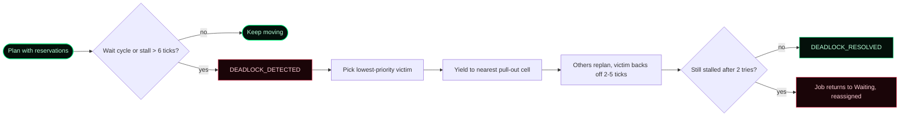
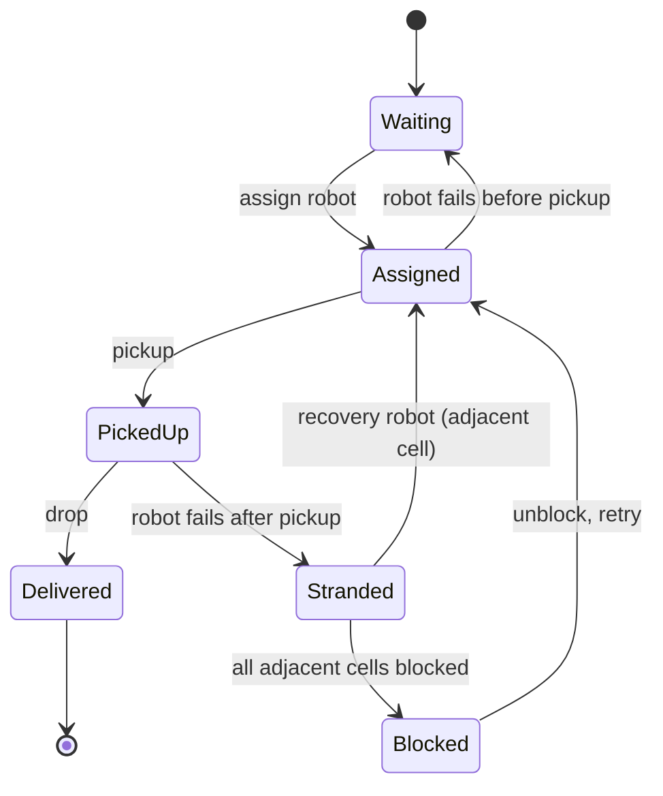

<div align="center">



### `> test your robot fleet before you buy one_`


**A free, browser-based sandbox for multi-robot coordination, deadlocks and failure recovery.**
**Every decision is explained in a human-readable event log.**

</div>

---

## `01 // THE PROBLEM`

Each robot has a valid shortest path. Put ten of them in one-tile-wide aisles and you get:

| Head-on | Swap | Deadlock | Robot failure | Blocked aisle |
|:--:|:--:|:--:|:--:|:--:|
| face-off in a 1-cell aisle | two robots exchange cells | circular standoff | package left stranded | route closes mid-shift |

## `02 // WHAT ROBOWAY DOES`

| Capability | How |
|---|---|
| **Model the arena** | Grid, obstacles, pickups, drops, 5+ robots, add jobs while running |
| **Route in space and time** | Greedy nearest-robot assignment + Space-Time A* + reservation table of `(x, y, t)` |
| **Prevent conflicts** | Vertex and edge (swap) checks, plus a runtime invariant checker every tick |
| **Handle deadlocks** | Wait-for graph or stall threshold, then yield, back-off and replan |
| **Recover failures** | Failed robot becomes an obstacle; package goes back to *Waiting* or becomes *Stranded*; one owner at all times |
| **Adapt live** | Click to block or unblock a cell; only affected robots replan; no reset |
| **Measure** | Completed jobs, waiting time, congestion heatmap, conflicts prevented, JSON log export |

> **Honest claim:** RoboWay does **not** claim zero deadlocks. It *prevents* where possible (reservations), *detects* (wait-for graph / stall), and *recovers* (back-off). Dense grids can still deadlock.

## `03 // ARCHITECTURE`

<div align="center">

</div>

The server is the single source of truth. The 2D and 3D views only render the same state JSON and send commands.

**Per tick:** apply commands → assign jobs → replan invalid routes → check conflicts and deadlocks → advance robots → update metrics and log → broadcast one state snapshot.

## `04 // THREE LAYERS AGAINST DEADLOCK`



## `05 // PACKAGE OWNERSHIP`



Invariants checked every tick: one owner per job, one job per robot, a Delivered job never changes, delivered count never decreases.

## `06 // DEMO SCENARIOS`

| Button | What you see |
|---|---|
| `narrow_passage` | One-cell corridor, three robots. Waits, avoided swap, stall detected, one robot yields to the pull-out cell. |
| `failed_robot` | Fail a robot before pickup (job reassigned) and after pickup (package Stranded, recovered, delivered once). |
| `blocked_aisle` | Block a cell mid-aisle; affected robots reroute via the other aisle; unblock later. |

> Seeds are fixed. The narrow-passage seed is verified to really deadlock, and detector output is never faked.

## `07 // QUICK START`

```bash
# backend
cd backend
pip install -r requirements.txt
uvicorn main:app --host 0.0.0.0 --port 8000

# frontend (second terminal)
cd frontend
npm install
npm run dev -- --host
```

Open `http://<your-laptop-ip>:5173` (use the laptop's network address, not `localhost`, if you want to open it on a phone).

> **Why plain http?** An HTTPS page cannot open a `ws://` connection to a local address (mixed content). Run the live demo fully local; use Netlify/Vercel only for the landing page and backup video.

## `08 // API CHEAT SHEET`

<details>
<summary><b>Click to expand</b></summary>

| Method | Path | Purpose |
|---|---|---|
| GET | `/api/state` | Full state JSON |
| POST | `/api/scenarios/{id}/load` | Load a scenario |
| POST | `/api/sim/start`, `/pause`, `/speed` | Control the sim |
| POST | `/api/jobs` | Add a job while running |
| POST | `/api/jobs/validate` | Dry-run edit |
| PATCH | `/api/jobs/{id}` | Edit a Waiting/Assigned job |
| POST | `/api/cells/block`, `/unblock` | Block or unblock a cell |
| POST | `/api/robots/{id}/fail` | Fail a robot |
| GET | `/api/events?since=N` | Event catch-up |
| WS | `/ws` | `state`, `event`, `error` messages |

</details>

## `09 // METRICS`

<details>
<summary><b>Click to expand</b></summary>

- **Completed jobs:** Delivered / total
- **Waiting time:** ticks a robot with a task chooses to wait
- **Conflicts prevented:** counted *per plan* (a plan had to wait or detour because of a reservation)
- **Congestion index:** occupied or reserved walkable cells, averaged over the last 20 ticks
- **Invariant violations:** target is 0
- **Deadlocks resolved, reassignments:** counters

- Ticks start at zero; events record the tick in which the operation occurs.
- Scenario jobs become available at their declared `at_tick`.
- Edit suggestions select a currently configured pickup/drop by Manhattan proximity when the requested route is unavailable.
- A stranded package remains recoverable at its failure coordinate; a robot that fails before pickup leaves an obstacle at its cell.

## Run everything

From the repository root in PowerShell:

```powershell
.\start_all.ps1
.\start_all.ps1 -Demo
.\scripts\verify_all.ps1
.\stop_all.ps1
```

The launcher creates the root `.venv`, installs backend/frontend dependencies when needed, opens the dashboard, and prints a phone-monitor QR link. Add `-NoBrowser` to suppress opening the dashboard or `-Tunnel` to request a Cloudflare quick tunnel. Logs and managed process IDs are stored under `logs/`.

All numbers come from the run itself. No benchmarks against other systems.

</details>

## `10 // LIMITATIONS AND FUTURE WORK`

- Simulation only. No real robots. Battery and charging are out of scope.
- Deadlocks can still occur on dense grids; RoboWay detects and recovers.
- **Future:** camera-based obstacle injection (OpenCV) via the same block API, and a real-robot adapter (MQTT or ROS 2). Not built or tested here.

## `11 // TEAM`

| Member | Role |
|---|---|
| _name_ | Backend and engine |
| _name_ | Frontend and landing page |
| _name_ | 3D viewer and polish |
| _name_ | Integration and pitch |

<div align="center">

`NexHack 2.0 // Geeta University // Problem Statement 5`

</div>
