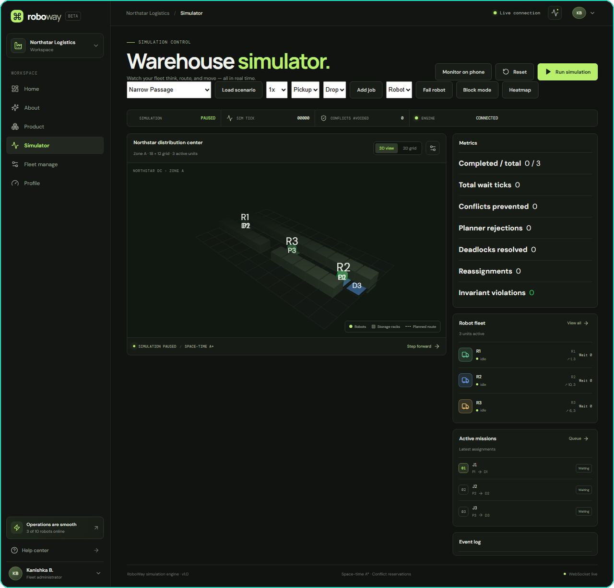
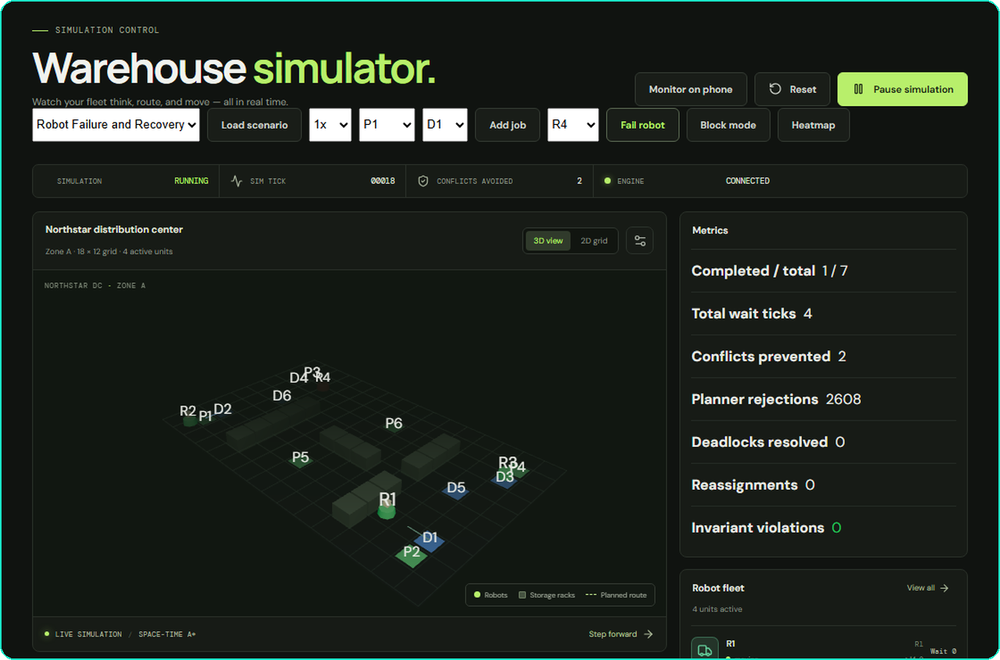
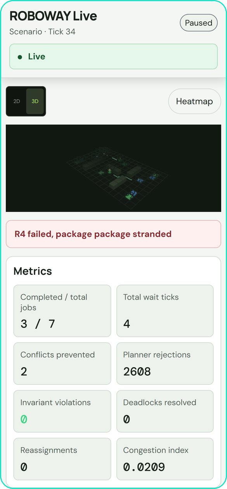
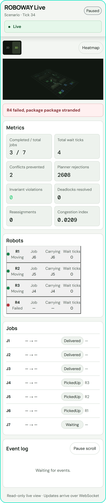
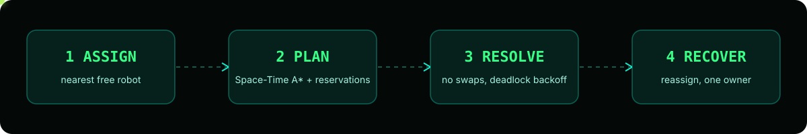
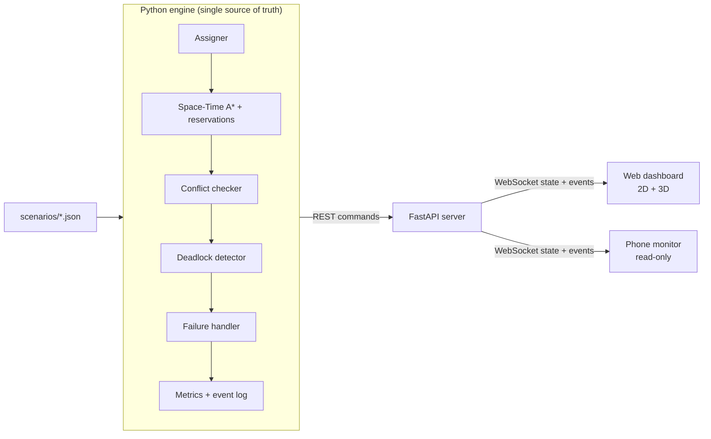

<div align="center">


<br>


### Test your robot fleet before you buy one.

A free, browser-based sandbox for multi-robot coordination and failure recovery.<br>
Every decision the fleet makes is explained in a human-readable event log.

<br>

[**Live preview**](#-live-preview) · [**Screenshots**](#-screenshots) · [**How it works**](#-how-it-works) · [**Demo scenarios**](#-three-demo-scenarios) · [**Quick start**](#-quick-start) · [**Phone monitor**](#-monitor-from-your-phone)


</div>

## ⚡ Live preview

<div align="center">

<br>
<sub>Illustrative animation of the idea: one robot crosses the one-cell aisle, another waits and follows, and the log explains why. The real simulator is shown below.</sub>
</div>


## 🖥️ Screenshots

**Simulator dashboard**, with scenario picker, speed, add job, fail robot, block mode and heatmap controls:

<div align="center">

</div>

<br>

**Robot failure and recovery running live.** R4 has failed, J4 is `Stranded`, and the other robots keep delivering. Every package still has exactly one owner:

<div align="center">

</div>

<br>

**Phone monitor**, a read-only live view you open by scanning a QR code (2D or 3D, tap a robot to follow it):

<div align="center">

<br>
<sub>Same state stream as the dashboard, on a phone. The full page also lists robots, jobs and the event log.</sub>
</div>

<details>
<summary><b>See the full phone page</b></summary>
<br>
<div align="center">

</div>
</details>


## 🎯 What it solves

Fleets of warehouse robots fail in four predictable ways. ROBOWAY lets you reproduce each one, watch it, and see the recovery:

| Failure | What happens in ROBOWAY |
|---|---|
| 💥 **Collisions in shared aisles** | Routes are planned in space **and** time with a reservation table, so no two robots share a cell and none swap head-on |
| 🔒 **Deadlocks in narrow passages** | Detected with a wait-for graph and a stall threshold, then resolved by yielding and backoff |
| 📦 **Robot failures with package loss** | Work is reassigned. A package is never carried or delivered by two robots, and completed deliveries are never touched |
| 🚧 **Blocked aisles mid-shift** | Click a cell to block it. Only the affected robots replan, and the simulation never resets |

<div align="center">

### The six mandatory requirements, mapped

</div>

| # | Requirement | Where to see it |
|---|---|---|
| 1 | Configurable arena, live job adding | Scenario picker, **Add job** while running |
| 2 | Assign and route in space and time | Planned-route lines, Space-Time A* + reservations |
| 3 | No collisions or swaps, deadlock recovery | `invariant_violations` stays **0**, deadlock events in the log |
| 4 | Failure recovery with correct ownership | **Fail robot**, `Stranded` then recovered, one `DELIVERED` per job |
| 5 | Adapt to disruptions without reset | **Block mode**, `REPLAN` events, tick counter keeps running |
| 6 | Measure the fleet | Metrics panel: completed jobs, waiting time, congestion |


## 🧠 How it works

<div align="center">

</div>

<br>

1. **Assign:** each waiting job goes to the nearest free robot, using real path cost rather than straight-line distance.
2. **Plan:** Space-Time A* searches `(x, y, t)` states against a reservation table (prioritized planning). Robots can wait as well as move.
3. **Resolve:** vertex and swap conflicts are blocked at planning time and re-checked every tick. If robots still stall, the engine builds a wait-for graph, picks a victim, and has it yield and back off.
4. **Recover:** when a robot fails, its job goes back to `Waiting` (before pickup) or becomes `Stranded` at the failure cell (after pickup) and another robot completes it.

**Package ownership state machine**

```text
Waiting ──assign──▶ Assigned(R) ──pickup──▶ PickedUp(R) ──drop──▶ Delivered
   ▲                    │                        │
   └──── R fails ───────┘                        └── R fails ──▶ Stranded ──▶ Assigned(R2) ──▶ PickedUp(R2)
```

Invariants are checked every tick: one owner per job, one job per robot, delivered jobs never change, no vertex or swap conflicts. Any breach is counted and logged, and the target is always `0`.

### Architecture



The server owns the simulation. The dashboard, the 3D view and the phone monitor only **render** the state JSON they receive, so they can never disagree with each other.


## 🎬 Three demo scenarios

Each loads with one click from the scenario picker.

<details open>
<summary><b>1 · Narrow passage:</b> head-on traffic in a one-cell aisle</summary>

<br>

Three robots, one corridor. One robot waits, nobody swaps cells, a wait cycle is detected, the lowest-priority robot yields, and everyone finishes.

You should see these kinds of lines in the log:
`WAIT` · `CONFLICT_AVOIDED` · `DEADLOCK_DETECTED` · `DEADLOCK_RESOLVED`
</details>

<details>
<summary><b>2 · Robot failure and recovery:</b> before and after pickup</summary>

<br>

Fail one robot before it picks up (its job returns to `Waiting` and is reassigned), then fail another while it carries a package (the job becomes `Stranded`, another robot recovers it). Every job ends with exactly one `DELIVERED` event.

`ROBOT_FAILED` · `JOB_REASSIGNED` · `PACKAGE_STRANDED` · `PICKUP` · `DELIVERED`
</details>

<details>
<summary><b>3 · Blocked aisle:</b> disruption without a reset</summary>

<br>

Two parallel aisles. Block a cell while robots are mid-aisle. Affected robots reroute through the other aisle, the tick counter keeps running, and all jobs still complete.

`CELL_BLOCKED` · `REPLAN` · `CELL_UNBLOCKED`
</details>


## 📊 Metrics

| Metric | Meaning |
|---|---|
| **Completed / total jobs** | Jobs in the `Delivered` state out of all jobs |
| **Total wait ticks** | Ticks where a robot had a task and chose to wait (idle time is not counted) |
| **Conflicts prevented** | Times a robot had to wait because another robot held its next cell |
| **Planner rejections** | Candidate moves the planner discarded due to reservations (not a collision count) |
| **Congestion** | Occupancy index and per-cell heatmap |
| **Deadlocks resolved / reassignments** | Counters |
| **Invariant violations** | Safety-check failures. Should always be `0` |

All numbers come from the run itself. Nothing is a benchmark against other systems.


## 🚀 Quick start

**Requirements:** Python 3.11+, Node.js 18+. Windows PowerShell is the primary platform.

### One command

```powershell
.\start_all.ps1            # backend + frontend + links + phone QR
.\start_all.ps1 -Demo      # also plays all three scenarios hands-free
.\scripts\verify_all.ps1   # runs every check and prints READY / NOT READY
.\stop_all.ps1             # stop everything
```

Open the dashboard at `http://localhost:5173`.

### Manual

```powershell
# backend
python -m pip install -r requirements.txt
python run_server.py --host 0.0.0.0 --port 8000

# frontend (second terminal)
cd frontend
npm install
npm run dev
```

### Terminal demo (no browser needed)

```powershell
python demo_cli.py                                          # interactive ASCII view
python demo_cli.py --scenario narrow_passage --scripted     # hands-free
python demo_cli.py --scenario narrow_passage --scripted --no-ui
```

Keys: `1` `2` `3` scenarios · `SPACE` pause · `+` `-` speed · `n` step · `a` add job · `f` fail robot · `b` `u` block / unblock · `r` restart · `e` export log · `q` quit.

### Tests

```powershell
python -m pytest -q          # engine + server
cd frontend; npm test        # frontend
```


## 📱 Monitor from your phone

1. Open the dashboard using your **laptop's network IP** (for example `http://192.168.1.23:5173`), not `localhost`.
2. Click **Monitor on phone** and scan the QR code.
3. Keep the phone and laptop on the **same Wi-Fi or hotspot**, and allow ports `8000` and `5173` in Windows Firewall.

The phone page is read-only: live 2D or 3D grid, alerts for deadlocks and failed robots, metrics, robot and job lists, and the event log. Tap a robot to follow it in 3D.

Need access from outside your network? Run `.\start_all.ps1 -Tunnel` (requires `cloudflared`) and use the HTTPS link it prints.


## 🔌 API

Base URL `http://localhost:8000`. Full contract and JSON examples live in [`docs/CONTRACT.md`](docs/CONTRACT.md).

<details>
<summary><b>REST endpoints</b></summary>

<br>

| Method | Path | Purpose |
|---|---|---|
| GET | `/api/state` | Full state snapshot |
| GET | `/api/scenarios` | List scenarios |
| POST | `/api/scenarios/{id}/load` | Load a scenario |
| POST | `/api/sim/start` · `/pause` · `/step` | Run, pause, single tick |
| POST | `/api/sim/speed` | Set speed (0.5, 1, 2, 4) |
| POST | `/api/jobs` | Add a job while running |
| POST | `/api/jobs/validate` | Dry run: `valid` or `conflict` with a suggestion |
| PATCH | `/api/jobs/{id}` | Edit a job (goes through the same planner) |
| POST | `/api/cells/block` · `/unblock` | Disrupt or restore a cell |
| POST | `/api/robots/{id}/fail` | Fail a robot |
| GET | `/api/events?since=N` | Event log catch-up |
| GET | `/api/metrics` | Metrics only |
| GET | `/api/ml/status` | Whether an ML predictor is loaded |
| WS | `/ws` | Pushes `state` and `event` messages |
</details>

<details>
<summary><b>State snapshot (shortened)</b></summary>

```json
{
  "tick": 42,
  "status": "running",
  "scenario_id": "narrow_passage",
  "grid": { "width": 12, "height": 7, "obstacles": [[3,0]], "blocked": [[7,3]],
            "pickups": [{"id":"P1","pos":[1,3]}], "drops": [{"id":"D1","pos":[10,1]}] },
  "robots": [{ "id":"R1", "pos":[4,3], "status":"moving", "carrying":"J1",
               "path":[[5,3,43],[6,3,44]], "wait_ticks":2 }],
  "jobs":   [{ "id":"J1", "state":"PickedUp", "owner":"R1" }],
  "metrics": { "completed_jobs":3, "invariant_violations":0 }
}
```
</details>


## 🗂️ Repository layout

```text
roboway/            simulation engine (planner, reservations, conflicts, deadlock, failures, metrics, server)
roboway/ml/         optional predictor adapter (disabled until a model is configured)
frontend/           React + Vite + TypeScript dashboard, 3D view, /monitor phone page
scenarios/          narrow_passage, failed_robot, blocked_aisle
tests/              pytest suite
scripts/            end-to-end checks and demo autoplay
docs/CONTRACT.md    state and API contract shared by every module
legacy/             early mock backend, kept for reference
```

## 🧭 Honest limits and roadmap

- **Simulation only.** No real robots, and no claims about physical deployment.
- **No battery model.** The engine does not simulate battery, so the UI does not show one.
- **ML is a plug-in point, not a feature yet.** `roboway/ml/` and `/api/ml/*` exist, but no model is loaded. Predictions would be advisory and never feed the planner automatically.
- **Future work:** camera-based obstacle injection (OpenCV) through the same block/unblock API, and warehouse map upload.

## 👥 Team

Built in 15 hours at **NexHack 2.0, Geeta University** (Problem Statement 5: Warehouse Robot Coordination Arena).

| Name | Role |
|---|---|
| _Your name_ | Simulation engine and integration |
| _Teammate_ | Website and control panel |
| _Teammate_ | Backend support, scenarios and tests |
| _Teammate_ | 3D / 2D viewer |

<div align="center">


<sub>ROBOWAY · plan in space and time · explain every decision</sub>

</div>
